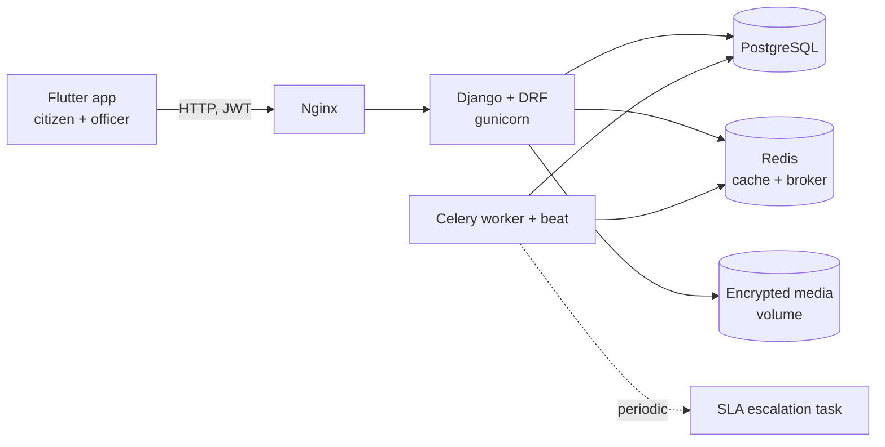

# JanMitra

JanMitra is a reporting and case-management backend for police intelligence
work. Citizens ("JanMitra" members) submit incident reports with photos, video
or audio from a Flutter app; officers triage them into cases, investigate,
and close them. Cases that sit unattended past their SLA are escalated up the
command chain automatically, and sensitive actions are written to an audit
log.

This repository holds the Django REST API, its Docker setup and deployment
scripts. The Flutter app is referenced as a git pointer only (see
[docs/repository-layout.md](docs/repository-layout.md)).

## Problem

Informant reports arrive unstructured and are easy to lose between police
stations and higher offices. The system has to:

- accept reports from registered, device-bound citizens without exposing
  their identity to every officer who touches the case;
- route each case to the right station and make sure only officers in that
  chain can see it and its media;
- escalate cases nobody acts on within 48 hours;
- keep a record of who viewed what, including identity reveals.

## Architecture



Django apps in `backend/`:

| App | Responsibility |
|-----|----------------|
| `authentication` | Custom user model, L0-L4 officer roles, JanMitra profiles, device sessions, invite codes, JWT login |
| `reports` | Incidents, cases, notes, status history, investigation messages, escalation service and Celery task |
| `media_storage` | Encrypted media storage and access logging |
| `audit` | Audit log, identity-reveal log, request middleware |
| `notifications` | In-app notifications |
| `core` | Base models, pagination, exception handling, test helpers |

Role hierarchy: L0 field officer, L1 station officer (PSO), L2 inspector,
L3 higher authority, L4 top authority. Station-level cases (L0-L2) escalate
to L3 after 48 h, L3 to L4 after a further 48 h; L4 has no SLA.

## Stack

Python, Django, Django REST Framework, SimpleJWT, PostgreSQL, Redis, Celery
(worker with embedded beat), gunicorn behind nginx, Docker Compose, optional
Sentry. Versions are pinned in `backend/requirements.txt`.

## Engineering decisions

- **Object-level access, not just role checks.** "Is this user an officer?"
  is not enough. Every endpoint that takes a case, incident or media id goes
  through `reports/access.py`, which applies the same visibility rules as the
  list queryset (`visible_cases_for_user`), so list and detail views cannot
  drift apart.
- **Device fingerprints are stored hashed.** Login looks profiles up by the
  SHA-256 of the fingerprint. Registration used to store the raw value, which
  locked those users out; migration
  `authentication/0008_hash_raw_device_fingerprints` repairs existing rows.
- **Escalation runs as a scheduled task.** `reports.tasks.escalate_sla_breaches`
  is safe to re-run: escalating resets the deadline, so a case is only picked
  up again once the next level's SLA has also expired. The
  `auto_escalate_cases` management command calls the same service.
- **Configuration comes from the environment.** Secret key, allowed hosts
  (never a wildcard), cache URL, number of trusted proxies (used when reading
  client IPs for audit records) and the demo seed password are read from
  `.env`. `seed_users` refuses to fall back to a built-in password when
  `DEBUG=False`.
- **Explicit upload limits.** Non-file request bodies are capped at 10 MB and
  uploaded files are spooled to disk above 5 MB rather than held in memory.

## Running locally

With Docker:

```bash
cp .env.example .env        # fill in SECRET_KEY, DB password, SEED_USER_PASSWORD
docker-compose up -d --build
docker-compose exec django python manage.py migrate
docker-compose exec django python manage.py seed_users
```

The API is then served through nginx at `http://localhost/api/`.

Without Docker, for running the tests or poking at the models:

```bash
cd backend
python -m venv .venv && . .venv/bin/activate   # Windows: .venv\Scripts\activate
pip install -r requirements.txt
python manage.py check --settings=janmitra_backend.settings_test
```

For a long-running local server, create a `.env` with
`DATABASE_ENGINE=django.db.backends.sqlite3` and a `SECRET_KEY`, then
`python manage.py migrate && python manage.py runserver`.

## Tests

```bash
cd backend
python manage.py test --settings=janmitra_backend.settings_test
```

`settings_test` uses in-memory SQLite, a local-memory cache, a temporary
media directory, eager Celery tasks and `DEBUG=False`, so no Postgres, Redis
or `.env` is needed. The suite has 113 tests covering authentication and
device binding, case visibility and media access, escalation, audit logging
and notifications.

`backend/scripts/manual/` holds scripts that call a running server over HTTP;
they are not part of the automated suite.

## Deployment

See [docs/deployment/deployment.md](docs/deployment/deployment.md).
`scripts/deploy_v1.sh` generates a production `.env` with random secrets on
first run.

## Known gaps

- The Flutter source is not in this repository (gitlinks without
  `.gitmodules`).
- The demo deployment runs over plain HTTP with `CORS_ALLOW_ALL_ORIGINS=True`;
  both need tightening before real use.
